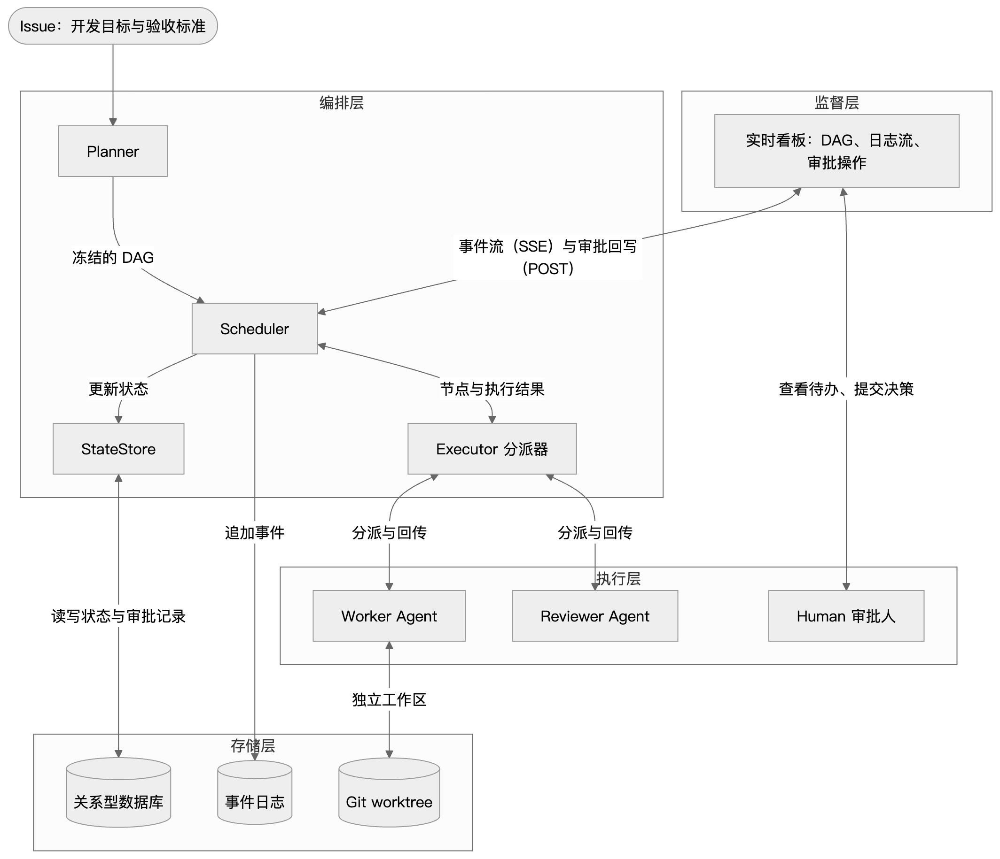
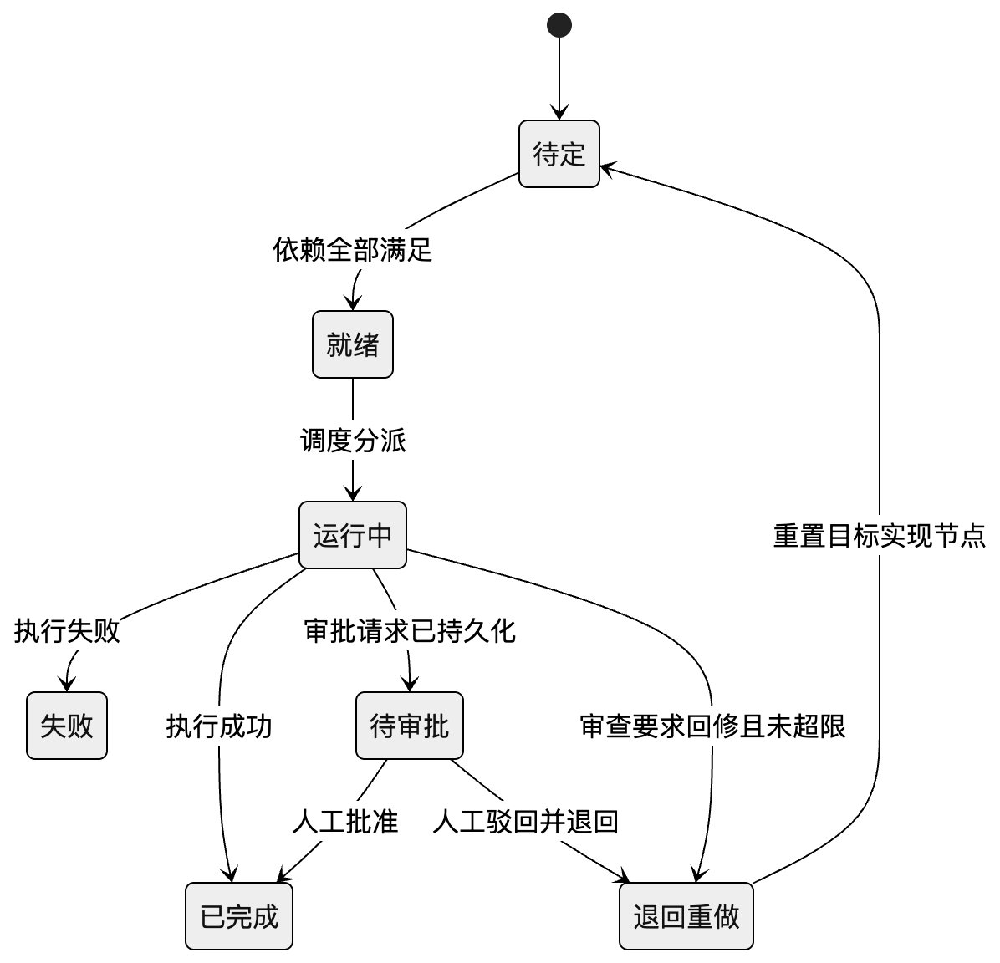
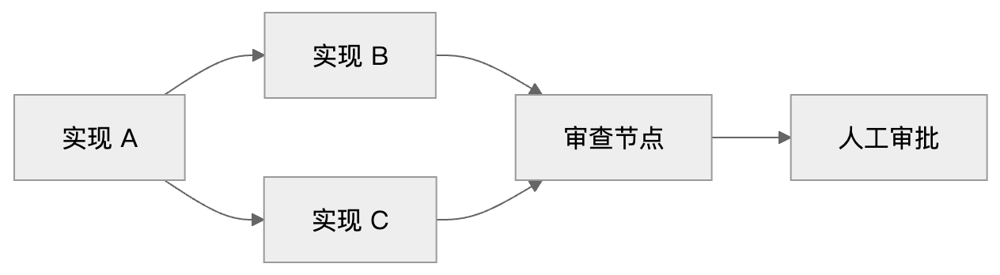
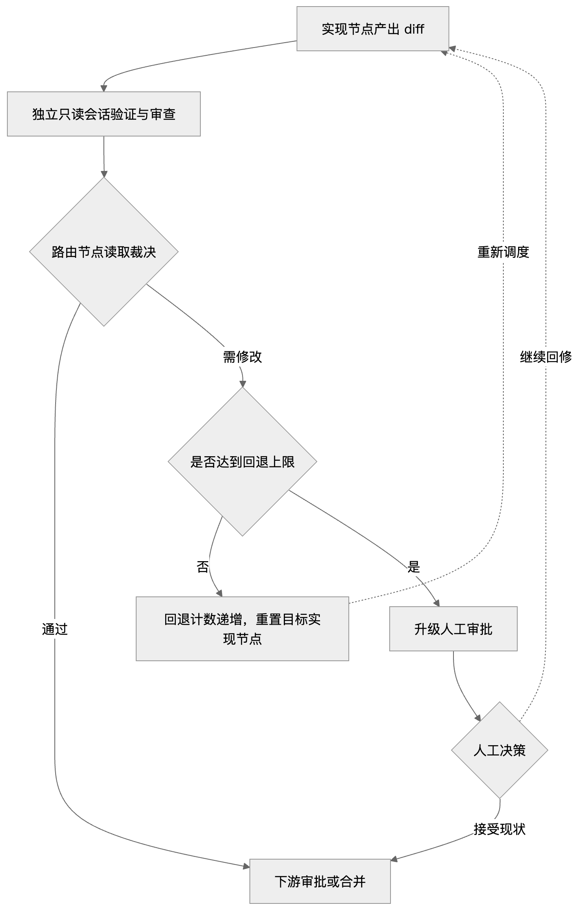
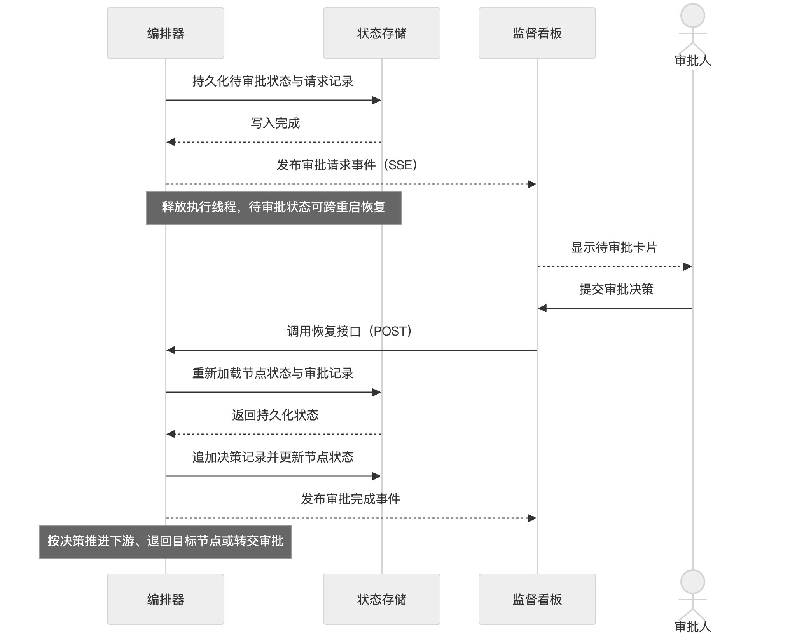
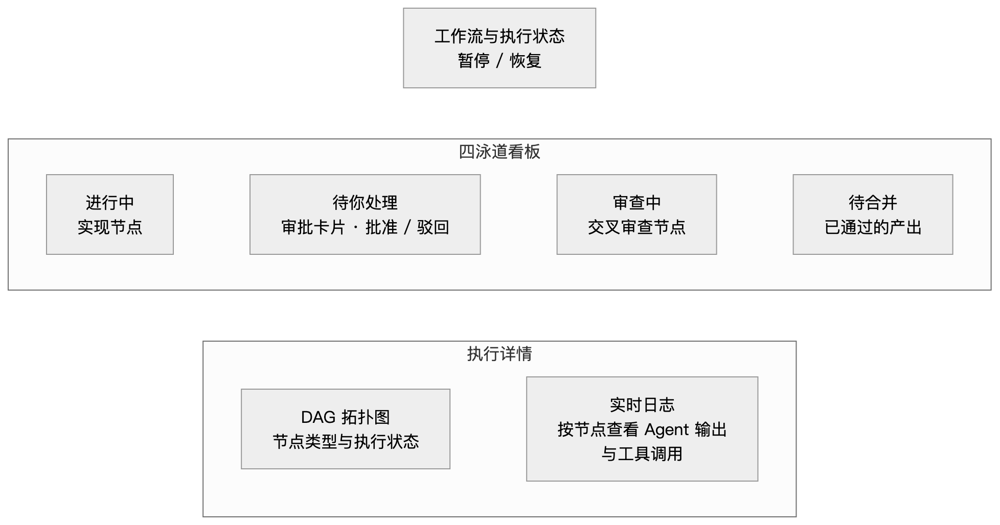

# Agent Orchestrator 设计文档

**版本**：v1.0（独立架构设计版）　**语言**：TypeScript　**核心理念**：基于图的智能体编排与质量控制

## 1. 概述

本系统是一个基于图的 Agent 编排器。它的核心目标是将一个模糊的开发目标分解为若干子任务，把每个子任务及相关的质量控制环节建模为图中的节点，由编排器（Orchestrator）作为主负责人，完成任务的分配、调度、审查和人工审批的闭环推进。

在设计上，系统采用了“生命周期闭环”与“质量控制循环”双重视角：

1. 生命周期闭环：规划（Plan）→ 运行（Run）→ 监督（Supervise）。
2. 质量控制循环：实施（Implement）→ 独立验证（Verify）→ 对抗性审查（Adversarial Review）→ 质量门禁（Quality Gate）。

这两个视角在系统中统一映射为四个核心业务环节：设计规格 → 任务分解 → 编排器执行 → 执行可视化与交互。

### 1.1 设计目标

| 目标 | 说明 |
|---|---|
| 原子执行 | 每个实现任务在一个独立的 Agent 会话与独立 Git worktree 中完成，互不污染 |
| 串并结合 | 任务间依赖用有向无环图（DAG）表达，无依赖节点并行，有依赖节点串行 |
| 节点化审查 | 独立验证、对抗性审查与人工审批是图上的原生节点，与实现节点共享调度机制 |
| 高度可观测 | 所有节点状态变更通过事件流实时推送到实时看板 |
| 安全可恢复 | 审批暂停不阻塞进程，状态持久化后可跨重启恢复 |
| 自动闭环演进 | 审查驳回可触发自动回修，确保输出质量；超出阈值则触发人工兜底 |

## 2. 总体架构

系统分为四层，自上而下依次为监督层、编排层、执行层与存储层。

| 层 | 职责 | 核心组件 |
|---|---|---|
| 监督层 | 执行可视化与人工交互 | 实时看板、DAG 拓扑图、日志流、审批操作 |
| 编排层 | 规划、调度与状态迁移 | Planner、Scheduler、Executor 分派器、StateStore |
| 执行层 | 具体节点执行 | Worker（Agent）、Reviewer（Agent）、Human（审批人） |
| 存储层 | 状态与事件持久化 | 关系型数据库（节点/审批/工作流）、事件日志文件、Git worktree |

数据流方向：编排层向执行层下发节点任务 → 执行层回传结果 → 编排层更新状态并发布事件 → 监督层消费事件流渲染看板 → 人工决策经监督层回写编排层。



*图 1　四层总体架构*

## 3. 核心四环节映射

| 业务环节 | 生命周期映射 | 质量控制映射 | 系统实现 |
|---|---|---|---|
| ① 设计规格 | 接收需求，定义验收标准 | 定义输入与约束 | 以 Issue 为入口，Planner 产出冻结的 DAG 定义 |
| ② 任务分解 | Plan（拆解目标） | 规划执行步骤 | 生成节点 DAG，含实现、审查、审批、路由四类节点 |
| ③ 编排器执行 | Run（分配并运行） | 实施 → 验证 → 审查 → 门禁 | Scheduler 按依赖关系调度串行/并行批次，Executor 分派执行 |
| ④ 执行可视化/交互 | Supervise（监督） | 质量门禁（Human-in-the-loop） | 看板实时渲染事件流，提供审批操作，触发自动回修 |

## 4. 节点类型系统：四阶段循环的载体

所有环节统一为节点（Node）。节点是调度的最小单位。质量控制循环被具象化为节点图中的串联结构：

```text
[实现节点] → [审查节点（独立验证 + 对抗性审查）] → [审批节点（质量门禁）]
    ▲                                                     │
    └──────────────── 路由节点回退 ───────────────────────┘
```

### 4.1 四类节点

| 节点类型 | 执行者 | 质量控制职责 | 关键约束 |
|---|---|---|---|
| 实现节点 | Coding Agent | 实施 | 独立 worktree、独占文件范围、可并行 |
| 审查节点 | Reviewer Agent | 独立验证 + 对抗性审查 | 独立会话、只读文件系统、异构模型、有界轮次 |
| 审批节点 | 人类 | 质量门禁 | 状态持久化、不阻塞执行线程、可跨重启恢复 |
| 路由节点 | 编排器 | 裁决分支与回退 | 纯逻辑、无副作用、基于上游结果选择下游分支 |

### 4.2 节点状态

所有节点共享统一的状态机：待定 → 就绪 → 运行中 → 已完成 / 失败 / 待审批 / 退回重做。

- **待定**：依赖未满足，等待上游节点完成。
- **就绪**：依赖全部完成，进入调度候选集。
- **运行中**：已被调度器分派执行。
- **待审批**：审批节点特有的持久化暂停状态。
- **退回重做**：被审查节点驳回，重置为实现节点的待定状态，受最大轮次约束。



*图 2　节点运行状态*

图中的退回路径表示目标实现节点被重置。

### 4.3 节点公共属性

每个节点携带：唯一标识、节点类型、依赖列表、当前状态、已执行次数。已执行次数用于审查节点的回退轮次约束，超过上限则升级为审批节点的例外分支。

## 5. Worker：原子执行单元

一个实现节点 ⇔ 一个 Agent 会话 ⇔ 一个独立 worktree。

### 5.1 原子性的三重绑定

| 绑定 | 说明 |
|---|---|
| 任务绑定 | 一个 Worker 只负责一个实现节点，目标单一 |
| 会话绑定 | 一个 Worker 对应一个独立的 Agent 会话，上下文不与其他 Worker 共享 |
| 工作区绑定 | 一个 Worker 独占一个 Git worktree 和一条分支，文件系统级隔离 |

### 5.2 Worktree 管理约束

- **创建时机**：worktree 必须在 Agent 进程启动之前创建，Agent 全程只在该目录下读写文件。
- **清理顺序**：必须先删除分支、再移除 worktree。移除 worktree 会销毁 shell 的工作目录，顺序颠倒会导致后续 git 命令失败。
- **命名约定**：分支命名为 `node/<节点 ID>`，目录位于仓库根目录下的 `.worktrees/<节点 ID>`。

### 5.3 Agent 会话封装

系统不关心具体 Agent 的推理能力，只关心其生命周期。会话封装负责启动进程、转发输出到事件总线、等待退出码。Agent 接入通过统一配置抽象，Worker 不感知具体 vendor。

## 6. 任务分解（Planner）

### 6.1 输入输出

- **输入**：目标描述（Issue 正文）。
- **输出**：节点 DAG，包含节点列表与依赖边，明确串行与并行关系。

### 6.2 分解流程

```text
Issue 正文 → 结构化模型调用 → 节点与依赖边 → DAG 校验 → 冻结写入状态存储
```

冻结后的 DAG 不再修改，作为执行阶段的唯一事实源。

### 6.3 DAG 校验规则

| 校验项 | 目的 |
|---|---|
| 依赖存在性 | 每个节点的依赖必须指向图中真实存在的节点 |
| 无环性 | 执行图不允许存在环，保证调度可终止 |
| 文件范围不冲突 | 两个并行实现节点的独占文件集合不允许相交，是并行安全的静态保障 |
| 工具可用性 | 节点引用的工具必须在注册表中存在 |

校验不通过的 DAG 拒绝冻结，Planner 需重新生成。

## 7. 编排器调度循环

### 7.1 调度状态迁移

待定 → 就绪 → 运行中 → 已完成。失败则进入失败或退回重做；审批节点进入待审批并持久化暂停，等待人工决策后恢复。

### 7.2 串行与并行的表达

调度器维护一个就绪集合：所有依赖已完成的节点自动进入该集合。调度器从就绪集合中按并发上限取出节点执行，执行完成后重新计算就绪集合。

- **串行**：节点依赖前序节点，前序未完成时不会进入就绪集合。
- **并行**：多个节点依赖相同的上游且彼此无依赖，上游完成后同时进入就绪集合，被并发调度。

并发上限由配置控制，避免资源耗尽。同一批次内的并行节点由文件范围静态检查保证写冲突不发生。



*图 3　DAG 串并行调度示例*

A 完成后，B 和 C 可在并发上限允许、独占文件范围互不相交的情况下同时执行。B、C 均完成后，审查节点进入就绪。

### 7.3 执行分派

调度器根据节点类型将执行分派给对应执行器：实现节点交给 Agent 执行器，审查节点交给审查执行器，审批节点交给审批执行器，路由节点交给路由执行器。执行器返回后，调度器更新节点状态并发布事件。

## 8. 交叉 Review 与质量门禁

### 8.1 设计要点

| 约束 | 说明 |
|---|---|
| 异构模型 | 审查者与实现者使用不同供应商的模型，降低同源偏差 |
| 独立上下文 | 审查者会话不加载实现者的对话历史，只基于代码变更（diff）做独立判断 |
| 只读文件系统 | 审查阶段不允许修改代码，审查者只能产出裁决与问题清单 |
| 有界轮次 | 每个审查节点设有最大回退轮次，超过上限后不再回退，而是升级到人工审批节点 |

### 8.2 审查流程

```text
获取被审节点的 diff → 启动独立只读审查会话 → 审查者输出裁决（通过 / 需修改）与问题清单 → 路由节点根据裁决选择分支
```

### 8.3 闭环演进

- **通过**：审查节点完成，下游审批节点或合并节点进入就绪。
- **需修改**：实现节点被重置为待定，回退重做；回退次数递增。
- **超限**：审查节点不再回退，编排器动态插入一个升级审批节点，由人工决定是继续回修还是接受现状。

这一机制保证 Agent 之间不会无限扯皮，同时保留人工兜底。



*图 4　审查、回修与升级*

## 9. 人工审批节点（质量门禁）

### 9.1 核心约束：不阻塞、可恢复

审批节点不允许阻塞执行线程等待人工输入。正确做法是：

1. 持久化“待审批”状态与审批记录。
2. 发布“审批请求”事件，通知看板。
3. 释放执行线程，调度器继续处理其他就绪节点或休眠。
4. 人工决策后，通过恢复接口重新加载状态，推进图执行。

这样即使编排器进程重启，审批记录与图状态依然完整，可以从中断点恢复。



*图 5　人工审批暂停与恢复时序*

### 9.2 审批三种模式

| 模式 | 语义 | 后续动作 |
|---|---|---|
| 确认 | 批准或驳回当前产出 | 批准则推进下游；驳回则退回目标节点 |
| 退回 | 退回上游重做 | 目标节点重置为待定 |
| 转交 | 转交他人审批 | 生成新的审批记录，原记录标记为已转交 |

### 9.3 审批记录

审批记录为不可变追加：每次请求与决策都追加一条记录，包含工作流、节点、状态、决策人、理由、请求时间与决策时间。这保证了审计链完整，也支撑看板上“待处理”与“已处理”两个视图。

## 10. 状态持久化与事件流

### 10.1 持久化模型

| 存储对象 | 内容 | 特性 |
|---|---|---|
| 工作流 | 目标、状态、创建时间、冻结时间 | 一个工作流对应一次完整编排 |
| 节点 | 类型、负载、依赖、状态、执行次数 | 图的结构与运行时状态 |
| 审批记录 | 每次请求与决策 | 不可变追加，保证审计 |
| 事件日志 | 所有状态迁移事件 | 追加写，支持离线回放与调试 |

### 10.2 事件类型

系统在以下时机发布事件：

| 事件 | 触发时机 |
|---|---|
| 工作流冻结 | Planner 完成 DAG 校验并写入存储 |
| 节点开始 / 完成 / 失败 | 节点状态迁移 |
| Agent 输出 | Agent 进程产生标准输出 |
| 审查通过 / 驳回 | 审查节点产出裁决 |
| 审批请求 / 审批完成 | 审批节点进入待审批或人工做出决策 |
| 升级 | 审查超限或异常需要人工介入 |

事件是可视化层与编排层之间唯一的耦合点：编排层只负责发布，看板只负责消费，二者无需直接通信。

## 11. 执行可视化（监督层）

### 11.1 看板结构

看板由四个核心泳道组成：

| 泳道 | 内容 |
|---|---|
| 进行中 | 正在运行的实现节点 |
| 待你处理 | 等待人工决策的审批节点 |
| 审查中 | 交叉审查节点 |
| 待合并 | 全部通过、等待最终合并的产出 |

### 11.2 三个核心视图

1. **DAG 拓扑图**：节点按类型着色（实现蓝、审查紫、审批黄、路由灰），按状态变状态色（就绪灰、运行中脉冲、完成绿、失败红、待审批橙）。
2. **日志流**：按节点分组的 Agent 输出与工具调用记录，实时追加。
3. **操作区**：审批卡片上的批准 / 驳回按钮，以及编排器的暂停 / 恢复控制。



*图 6　监督看板布局示意*

### 11.3 数据流

```text
编排器事件总线 → 实时通道 → 前端事件分发器 → 拓扑图更新 / 日志追加 / 审批卡片刷新
```

前端只消费事件，不直接查询编排器内部状态，保证两层解耦。

## 12. 技术栈

### 12.1 后端

| 层 | 选型 | 理由 |
|---|---|---|
| 运行时 | Node.js 20+ 或 Bun | 与 Agent CLI 生态兼容，进程管理库成熟 |
| 语言 | TypeScript 5.x（严格模式） | 类型安全是图调度的必要保障 |
| HTTP 框架 | Fastify 或 Hono | 轻量、原生 TS 支持、便于接入 SSE |
| 实时通道 | SSE 优先，WebSocket 备选 | 单向事件流用 SSE 足够，审批回写走普通 POST |
| 持久化 | SQLite + Drizzle ORM | 单机原型零运维，类型推导友好 |
| 事件日志 | JSONL 追加写 | 与数据库互补，便于离线回放与调试 |
| DAG 调度 | 自研拓扑排序 | 依赖简单时自研可控，复杂时可引入轻量图库 |
| Schema 校验 | Zod | Planner 输出校验、事件负载校验 |
| 进程管理 | execa + node-pty | 一次性命令用 execa，交互式 Agent 需要 TTY |
| Git 操作 | simple-git | worktree、分支、diff、合并全覆盖 |
| 日志 | pino | 结构化日志，与事件流配合 |
| 包管理与构建 | pnpm + tsup / tsc | monorepo 友好，原型阶段构建简单 |
| 测试 | vitest | 与前端生态一致，速度快 |

### 12.2 前端

| 层 | 选型 | 理由 |
|---|---|---|
| 框架 | React 18 + Vite | 生态成熟，迭代快 |
| DAG 可视化 | React Flow | 专为节点图设计，自带布局、缩放与交互 |
| 状态管理 | Zustand | 轻量，适合事件驱动的局部更新 |
| 样式 | Tailwind CSS | 快速出界面 |
| 实时通道 | 原生 EventSource（SSE） | 无需额外库 |
| 日志面板 | 虚拟列表 | 长日志流性能保障 |

### 12.3 外部 Agent 接入

| Agent | 接入方式 |
|---|---|
| 标准 CLI Agent | 命令行调用 + 流式 JSON 输出 |
| 自定义 Agent | HTTP / gRPC 适配层 |

接入层以统一配置抽象，Worker 不感知具体实现。

### 12.4 目录结构

```text
orchestrator/
├── packages/
│   ├── core/        # 图调度、状态机、事件总线、worktree 管理
│   ├── planner/     # Planner 调用与 DAG schema 校验
│   ├── server/      # HTTP 服务、SSE、REST
│   └── web/         # React + React Flow 看板
├── pnpm-workspace.yaml
└── package.json
```

## 13. 原型实施路径（设计验证）

| 阶段 | 验证内容 | 对应环节 |
|---|---|---|
| 1. 单节点闭环 | Issue → 单节点 DAG → worktree 创建 → Agent 执行 → 状态回写 | 设计规格 → 任务分解 → 编排器 |
| 2. 串并行 DAG | 多节点依赖正确、并行 Worker 文件不冲突 | 任务分解 → 编排器执行 |
| 3. 交叉审查 | 异构模型、独立会话、驳回触发回退、超限升级 | 独立验证 → 对抗性审查 |
| 4. 人工审批 | 审批持久化、进程重启后恢复、恢复接口推进图执行 | 质量门禁 → 执行交互 |
| 5. 可视化 | 看板实时反映节点状态、审批按钮回写 | 执行可视化 |

每个阶段都应能以一段脚本端到端演示：给一个 Issue，看到 DAG 生成、并行执行、审查驳回、人工批准、合并完成的完整链路。

## 14. 关键设计决策摘要

1. **一切皆节点**：实现、审查、审批、路由共用同一套节点类型、调度器和事件流，质量控制循环被具象化为图上的节点串联，避免多套系统拼接。
2. **Worker 物理隔离**：一个实现节点一个 worktree，并行安全靠文件范围静态检查与 worktree 动态隔离双重保障。
3. **审查异构且有界**：审查者使用不同供应商的模型与独立上下文，配合回退轮次上限，防止 Agent 间无限扯皮；超限自动升级人工。
4. **审批不阻塞**：待审批是持久化状态而非内存等待，跨重启可恢复，对应“质量门禁”与“待你处理”泳道。
5. **状态由事实推导**：节点状态来自执行结果与 Git 状态，而非 Agent 自报。
6. **事件驱动可视化**：所有状态迁移发布事件，看板只消费事件流，与编排器解耦。
