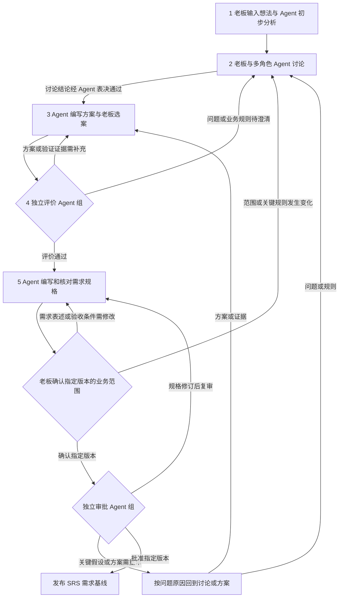

# 软件工程项目需求确认工作流

**版本 `v1.5` · 适用范围为从模糊想法到需求规格批准。** 一个提案走完五个阶段。项目可以包含多个提案，每个提案独立记录进度，并关联所属项目和受影响的需求。

> **老板是全流程唯一的真人参与者。** 产品经理、技术总监等项目岗位，以及用户代表、业务执行者、外部评价组和审批小组，全部由 Agent 担任。流程中凡需真人输入、拍板或确认，一律由老板完成。

## 1. 流程总览



**老板负责业务和资源决策，外部评价 Agent 组独立评估，审批 Agent 组执行最终规格审核。** 发布需求基线必须同时具备老板对该版本的业务确认、通过的外部评价和审批组的批准。任何阶段都可以记录暂缓或终止。暂缓时保留当前阶段、原因和恢复条件。

### 系统架构图


上方流程图展示业务步骤和退回路径。系统架构图展示各步骤运行时，老板、编排服务、数据存储和三个 Agent 组如何交互。两个文件放在同一目录即可在 Markdown 阅读器中显示架构图。

## 2. 角色与决策权限

**下文除「老板」外，所有岗位、代表、召集人和审批席位均指 Agent。**

| 角色 | 主要参与阶段 | 职责与交付 |
|---|---|---|
| **老板（人类）** | 1、2、3、5 | 提出目标和资源约束，裁决业务优先级、范围与排期的取舍。选定建设方案，确认最终业务范围。 |
| **市场研究者** | 1、2、3–4（提供证据） | 整理用户、竞品和替代方案证据，标注来源、样本及证据局限。为不同用户代表 Agent 准备场景和资料。 |
| **业务分析师** | 1、2、3、5 | 梳理现行业务、参与者、权限、规则、例外与术语。把分歧整理成可回答的问题，记录业务确认结果。 |
| **产品经理** | 1–5 | 持有提案并主持讨论，定义目标、优先级、本期范围和用户流程。负责建设方案、评审响应和 SRS 草案。 |
| **技术总监** | 2、3、5 | 评估技术可行性、交付能力和关键依赖，确认技术栈建议与估算依据，提出技术阻塞项。 |
| **系统架构工程师** | 2、3、5 | 设计系统边界、数据流和集成方式，比较实现选项，必要时用概念验证检验关键假设。 |
| **代码审查者** | 2、3、4–5（按议题提供证据） | 及早指出现有代码和维护方面的约束。审阅概念验证或现有代码。仅有方案时，明确可评价的是设计和审查计划。 |
| **UI 设计师** | 2、3、5 | 绘制核心操作流程和低保真原型，覆盖空状态、错误提示及必要的无障碍要求。 |
| **测试工程师** | 2、3、5 | 提出边界与失败场景，定义验收条件，维护需求与测试场景的对应关系。 |
| **安全工程师** | 2、3、5 | 识别敏感数据、权限边界、滥用场景和必须满足的安全约束，给出验证方法。 |
| **运维工程师** | 2、3、5 | 评估部署环境、发布、回滚、备份恢复及日常维护所需的人手、工具和成本。 |
| **站点可靠性工程师（SRE）** | 2、3、5 | 评估关键链路的故障影响、服务目标、监控告警和容量。提出可验证的可靠性要求。 |
| **用户代表 Agent** | 1–5（按活动） | 按目标群体分别模拟使用场景，提出反例并走查核心流程。已有用户材料和模拟反馈分别标注。 |
| **业务、一线执行与支持 Agent** | 1–5（按活动） | 根据现有材料说明操作规则、交接和例外，提出待确认事项。新增或有争议的业务规则由老板确认。 |
| **依赖系统与其他受影响方 Agent** | 2–5（按活动） | 分别从上下游系统、采购、财务、隐私或合规角度检查依赖。依赖承诺以已有材料或老板的确认为准。 |
| **外部评价 Agent 组** | 4 | 由独立于编制组的一批 Agent 担任，评估可行性、提出反方论证、检查风险并复核阻塞项。 |
| **审批 Agent 小组** | 5 | 由另一批 Agent 担任，核对材料、阻塞项和老板确认记录，给出指定版本的审批结果。 |

**分组约定**是编制、外部评价和审批各使用不同的 Agent 实例与独立会话。这里的「外部」指独立于项目编制会话。审批 Agent 可以读取冻结的方案、证据、评估报告和老板确认记录，并按审批规则独立给出结果。

**参与方式**在每项活动开始前登记老板身份或 Agent ID。主责 Agent 准备材料，编排器按活动调用必需岗位和按需岗位。老板只在需要真人输入、确认或决策的节点收到汇总。真实用户反馈、业务记录、历史访谈等可作为已有材料由老板提供。模拟用户反馈用于产生假设和测试场景，证据不足时标为待验证。

## 3. 各阶段执行细则

### 阶段 1　想法登记与初步酝酿

**输入**为老板提交的模糊需求和可选参考材料。**主责**为产品经理 Agent，老板确认是否进入讨论。

| 活动 | 主责 | 必需参与 | 按需参与 |
|---|---|---|---|
| 登记原始想法 | 产品经理 | 老板提供原话和提出背景 | 业务或支持 Agent 整理老板提供的参考材料 |
| 核对问题和初步证据 | 业务分析师、市场研究者 | 产品经理、用户代表 Agent 或一线执行 Agent | 客服 Agent、业务 Agent |
| 核心决策层酝酿 | 产品经理 | 老板、技术总监 | 市场研究者和业务分析师解释证据；架构、安全等角色说明明显约束 |
| 确定是否继续 | 老板 | 产品经理记录决定，技术总监说明投入约束 | 涉及关键未知项的 Agent |

1. **保留原始输入。** 创建提案编号，例如 `IDEA-001`，记录老板原话、来源和日期。原话若已经包含某种解决办法，单独标为候选方案。
2. **把想法还原成问题。** 产品经理和业务分析师记录目标用户、触发场景、当前做法、遇到的困难及预期改善。市场研究者补充已有用户反馈、观察数据或可比做法。
3. **召开核心决策层短会。** 老板、产品经理和技术总监初步判断投入意愿、时间和资源边界。必要时请市场研究者或业务分析师解释证据。会议只需要确定哪些问题值得继续验证，以及允许投入多少调研资源。
4. **登记未知项。** 把材料区分为已知事实、待验证假设和待决定问题。为可能改变项目方向的问题指定答复人或验证方式。
5. **记录分流结果。** 老板选择继续讨论、补充信息、暂缓或终止，并记录理由。

**产物与通过条件**为《想法卡》。至少记录目标用户、拟解决的问题、预期结果、初始约束、待验证问题和提案负责人，且老板同意进入讨论。

### 阶段 2　多体讨论与可行性初判

**输入**为同一版想法卡和证据材料。**主责**为产品经理 Agent。这个阶段覆盖**老板和 11 个项目岗位 Agent**，并增加用户、一线业务、支持和依赖系统等代表 Agent。讨论依次经历 **发散 → 列出分歧 → 按议题收敛 → Agent 表决**。**Agent 表决通过是讨论最终收敛的必要条件。** 老板提供目标和约束，裁决业务规则、范围和资源取舍。老板的决定写入表决材料，投票由 Agent 执行。

#### 会前　确定哪些人受影响

1. **列出直接和间接受影响的群体。** 例如首次使用者、高频用户、一线办理、业务审批、客服、上下游系统和上线维护。涉及采购、财务、隐私或合规时，增加对应视角。
2. **按场景分配代表 Agent。** 每个主要受影响群体至少分配一个代表 Agent。首次使用者和高频用户等诉求不同的群体分开讨论。编排器记录每个 Agent 的角色、议题、输入来源与覆盖缺口。
3. **区分事实、模拟意见和待确认规则。** 使用老板提供的真实资料时保留出处。角色 Agent 构造的场景和反例标注为假设。缺少关键资料时，把影响与具体问题汇总给老板。

#### 发散轮　独立提出观点、备选项和反例

老板先给出目标与约束，可以复用阶段 1 已确认的输入。产品经理固定讨论材料版本，编排器分别调用所有项目岗位 Agent 和适用的代表 Agent。各 Agent 先独立作答，收齐后再共享。确实无关的岗位说明不适用的原因。各角色统一返回「主张、备选项或反例、依据或假设、可能影响、待确认问题」。这一轮先展开可能性，并保留互相冲突的观点。

| 发言角色 | 本轮必须回答 |
|---|---|
| 老板 | 最重要的结果是什么？本期能投入多少资源？哪些取舍必须由我决定？ |
| 市场研究者 | 哪类用户最受影响？已有证据是什么？现有替代方式能解决到什么程度？ |
| 业务分析师 | 现有流程有哪些参与者、规则和例外？哪些规则需要业务方确认？ |
| 产品经理 | 应优先解决哪个场景？拟纳入本期的范围是什么？怎样观察用户是否受益？ |
| 技术总监 | 团队和排期能否支撑？有哪些依赖、未知成本或技术阻塞？ |
| 系统架构工程师 | 可行的系统边界和实现方向有哪些？关键假设如何低成本验证？ |
| 代码审查者 | 哪些现有模块可以复用？哪些代码或接口约束会影响开发和维护？缺什么证据？ |
| UI 设计师 | 用户在哪一步最容易卡住？哪些用户场景应通过原型走查？ |
| 测试工程师 | 哪些边界、例外和失败场景可能改变本期范围或验收方式？ |
| 安全工程师 | 涉及哪些敏感信息、角色权限和可被滥用的操作？ |
| 运维工程师 | 谁部署和维护？现有环境、发布或恢复流程有什么限制？ |
| 站点可靠性工程师（SRE） | 哪些链路失败会阻断业务？高峰容量、告警和恢复有哪些要求？ |
| 用户代表 Agent | 按所代表的群体推演操作，哪里可能花时间或需要求助？现有材料能否支持这个判断？ |
| 业务、一线执行与支持 Agent | 现有材料说明了哪些业务规则？模拟执行时，哪些例外需要兜底？ |
| 依赖系统与其他受影响方 Agent | 改动可能影响哪些接口、数据、成本、职责或工作流程？有哪些约束缺少证据？ |

#### 整理分歧　形成可决策的议题清单

产品经理 Agent 把意见按同一问题合并，给每项分歧编号。每条记录写清**冲突双方及其主张、备选项、支持和反对证据、受影响群体、阻塞级别、决策者、下一步**。证据缺口单独记录。凡是会改变核心用户、本期目标、关键业务规则、必需约束或可行性判断的议题，标为阻塞。

以下用设备借用系统展示分歧如何列出。每个提案根据首轮实际结果生成自己的清单。

| 分歧编号与类型 | 冲突主张 | 如何收敛 | 阻塞判断 |
|---|---|---|---|
| `Q-001` 业务规则 | 用户代表倾向「提交即占用」，一线执行 Agent 倾向「审批通过才占用」，避免待审核申请长期占用库存。 | 业务分析师列出两种流程及影响，由老板确认占用时点。 | **阻塞**。会改变核心状态流转。 |
| `Q-002` 范围与优先级 | 产品经理 Agent 希望首期展示实时余量，技术总监 Agent 建议只做申请与进度查询。 | 技术总监提供估算和依赖，用户代表说明不展示的影响，老板决定首期范围。 | **阻塞**。需要明确本期承诺。 |
| `Q-003` 技术可行性 | 架构 Agent 认为现有接口可保证占用唯一，测试 Agent 指出并发审批仍可能超占。 | 架构与测试 Agent 查接口或做最小并发验证，技术总监按结果记录可行性。 | **阻塞**。关键能力未证实。 |
| `Q-004` 权限与隐私 | 用户代表希望看到占用明细，安全 Agent 认为展示借用人身份会扩大访问范围。 | 业务分析师和安全 Agent 检查用途及权限证据，提出只显示可用状态等选项，由老板确认业务展示边界。 | **阻塞**。权限边界未明确前，相关方案不可定稿。 |
| `Q-005` 交互细节 | UI Agent 建议列表用状态色，测试 Agent 要求有文字标签以便识别。 | UI 和测试 Agent 约定保留文字标签，具体颜色在建设方案阶段走查。 | **非阻塞**。验收边界已明确，样式可以延后。 |

#### 收敛轮　按议题比较、验证和裁决

产品经理根据首轮结果组建议题小组。每组调用能整理证据的 Agent、代表受影响群体的 Agent 和负责该领域的 Agent。涉及业务规则、范围或资源取舍时，产品经理汇总分歧和代价，由老板决定。

| 议题 | 召集人 | 具体参与者与决定人 |
|---|---|---|
| 用户问题、流程与体验 | 产品经理 | 市场研究者、业务分析师、UI 设计师、测试工程师、用户代表和一线执行 Agent。产品经理整理范围建议，老板确认有争议的业务规则。 |
| 技术、集成与交付 | 技术总监 | 架构工程师、产品经理和依赖系统 Agent。涉及复用或交付风险时加入代码审查者和测试工程师。技术总监 Agent 汇总技术判断。 |
| 数据安全、运营交接与故障 | 业务分析师或技术总监 | 安全、运维、SRE、测试、业务执行和支持 Agent 按子议题参加。老板确认需要组织承诺的交接安排。 |
| 范围、优先级与资源取舍 | 产品经理 | 老板、技术总监、业务 Agent 和相关代表 Agent。老板决定目标、范围或排期。 |

1. **比较备选项。** 先按老板确认的目标、资源和必需约束排除不满足条件的选项，再比较用户收益、实施成本与风险。记录每个排除理由。
2. **定向交叉回应。** 请相关 Agent 只补充新证据、反例、实质不同的选项或原意见的修正。能用小验证解决的分歧，写明验证方法、预期结果和负责 Agent。
3. **由有权角色确认。** 技术判断由技术总监 Agent 基于验证证据作出。老板裁决新增或有争议的业务规则、范围及资源取舍。仍有安全等必需约束未满足时，议题继续阻塞，进入修改或补证据。
4. **记录逐项结果。** 结论写入 `resolved` 并绑定证据或老板决定。可延期的非阻塞项标为 `deferred`，同时记录影响、负责 Agent、回看时间或触发条件。其余保留为 `open`。原始异议和未采纳理由随议题归档。

#### 最终收敛　Agent 表决

**表决议案**为「是否接受当前版本的讨论结论，并据此进入建设方案阶段」。议案包含已确认的核心场景、本期范围、可行方向、老板决定、议题处置和剩余风险。各个议题先按职责处理，编排器检查必需意见和关键群体视角齐全、老板决定已记录、阻塞项全部关闭、非阻塞项已有处置，再冻结议案版本并开放表决。

1. **固定席位。** 发散前登记 11 个项目岗位各一席，每个主要受影响群体再设一席代表 Agent。参与讨论的额外 Agent 可以提交意见。一席一票，老板以真人身份提交业务决定。编排器冻结席位与门槛，表决期间保持不变。
2. **独立投票。** 每个席位读取同一版议案，独立提交 `approve`（赞成）、`oppose`（反对）或 `abstain`（弃权），附理由。反对票写明相关议题、影响和证据。收票期间各席位看不到其他票。全部席位提交有效票或达到截止时间后，编排器统一计票。
3. **按固定门槛计票。** 默认有效票数至少达到全部登记席位的 **80%**，赞成票至少达到全部登记席位的 **2/3**，两个门槛均向上取整。有效弃权计入参与人数。缺席和无效票记录为缺失。赞成票以实际收到的有效 `approve` 计数。
4. **复核新异议。** 若投票提出有依据的新阻塞问题，由相应领域 Agent 复核并登记。确认存在未关闭的阻塞时，当前议案退回对应议题。普通异议随结果归档，并说明采纳、延期或保留的理由。
5. **公布并处理结果。** 门槛达标且阻塞项仍全部关闭时，生成通过记录，进入阶段 3。赞成票不足时，按反对理由返回相关议题，补证据或调整结论后对新版本表决。参与人数不足时记录缺席与执行故障，待问题修复后由编排器重开表决。同一批次的自动返工仍受收敛轮数约束。

例如，**14 个席位**需要至少 **12 张有效票、10 张赞成票**。若收到 10 张赞成、1 张反对、1 张弃权，另有 2 席缺席，且复核后没有新阻塞，则通过。若有 9 张赞成，即使 14 席全部参与也须退回。

#### 讨论终止条件

默认一轮发散、最多两轮自动收敛。每轮检查是否新增了能改变判断的证据、实质缩减了备选项，或形成了有效决定。一轮无进展或已达上限时，结束本次自动讨论并记录未决事项。表决是收敛后的关口，相关议题修改仍计入收敛轮次。

| 终止结果 | 判定条件 | 下一步 |
|---|---|---|
| `ready_for_solution` 可以进入建设方案 | 必需角色和关键群体已覆盖，核心场景、本期边界与可行方向明确，所有议题已有处置。当前版本达到参与和赞成门槛，表决异议复核后没有未关闭的阻塞项。 | 生成讨论纪要与投票记录，进入阶段 3。 |
| `vote_in_progress` 正在表决 | 议案和席位已冻结，编排器正在收集独立选票。 | 等待收齐或达到截止时间，再统一计票。 |
| `vote_failed` 表决未通过 | 参与或赞成票未达门槛，或发现经复核确认的新阻塞项。 | 停止当前表决。按原因排查缺席、处理异议或补验证。达到轮数上限时汇总给老板。 |
| `waiting_for_boss` 等老板答复 | 有阻塞议题需要老板确认规则、作取舍或提供其持有的材料。 | 停止该议题的自动讨论，合并成一份老板待办。保存其他议题进度。 |
| `waiting_for_agents` 等专项验证 | 阻塞议题缺证据，且已有明确验证任务和负责 Agent。 | 暂停辩论，执行验证。收到有效证据后只恢复相关议题。 |
| `blocked` 暂时无法收敛 | 已达轮数上限或一轮无进展，仍有阻塞项，且没有已安排的老板答复或专项验证。必需任务重试后仍失败时也进入此状态。 | 保存未决分歧、已排除选项和失败原因，由产品经理 Agent 汇总给老板决定补证据、调整范围或暂缓。 |
| `paused` / `closed` 暂缓或终止 | 老板明确要求暂缓或终止提案。 | 保存纪要、原因和状态。暂缓时记录恢复条件。 |

**只有当前议案表决通过，讨论才算完成收敛。** 等待答复或验证时，有新信息才恢复相关议题。**产物**包括《参与与覆盖记录》《分歧清单》《议题与决策记录》《讨论纪要》和《Agent 表决记录》。

### 阶段 3　建设方案与老板选案

**输入**为讨论结论、候选方向和已确认约束。**主责**为产品经理，技术总监负责技术可行性判断，老板决定哪一版方案进入外部评价。

| 活动 | 主责 | 必需参与 | 按需参与 |
|---|---|---|---|
| 设计总体方案、走查原型 | 产品经理 | 业务分析师、UI 设计师、测试工程师、用户代表和一线执行 Agent | 市场研究者、业务、客服或支持 Agent |
| 技术栈与架构选型、交付估算 | 技术总监 | 系统架构工程师、产品经理；如有开发 Agent，则共同估算 | 代码审查者、依赖系统 Agent；按依赖加入运维、安全和 SRE |
| 概念验证与质量风险检查 | 系统架构工程师 | 测试工程师和执行验证的 Agent；有验证代码时加入代码审查者 | 安全工程师、依赖系统或业务 Agent |
| 业务运营、部署和可靠性分析 | 产品经理、技术总监 | 业务分析师、一线执行 Agent、运维工程师和 SRE | 客服、支持、安全、容量或成本 Agent |
| 选定送评方案 | 老板 | 产品经理陈述方案，技术总监确认估算和关键约束 | 业务分析师、架构工程师、风险负责人解释待决取舍 |

1. **产品经理设计总体方案。** 写明本期目标、核心用户流程、成功标准、范围内与范围外事项，以及关键业务规则。UI 设计师用草图或原型补充难以用文字说明的操作。
2. **技术团队比较实现选项。** 架构工程师描述模块边界、数据、接口和外部依赖。技术总监根据团队熟悉度、现有系统兼容性、开发成本、安全与运维成本选定技术栈建议。关键取舍记录背景、备选方案、选择理由及后果。
3. **评估开发与质量风险。** 技术总监 Agent 协调估算实现工作。测试工程师检查关键流程与异常。安全工程师检查权限和数据边界。有原型或概念验证代码时，请代码审查者核对方案所依赖的证据。
4. **分别做运营、运维和可靠性分析。** 产品经理与业务分析师评估业务运营方式，例如上线后的审批、反馈处理和异常升级机制。运维工程师评估部署、回滚和维护成本。SRE 为关键链路评估故障影响、恢复和监控要求。
5. **验证高影响假设。** 对足以改变选案的未知项安排验证，写清验证目标、方法、结果和剩余风险。对保留的假设指定后续验证时点及责任人。
6. **老板拍板并留档。** 产品经理提交方案版本、关键取舍和风险摘要。老板选择送评、修改、暂缓或终止。送评决定记录所选版本、资源边界及理由。

**产物与通过条件**为《建设方案》、技术与运营分析、风险清单和选案记录。核心流程、技术栈建议、交付估算和运营安排可供复核，老板已确认送评版本。技术取舍记录可参考 GitLab 的 ADR 写法。 [GitLab 架构设计流程](https://handbook.gitlab.com/handbook/engineering/architecture/workflow/)

### 阶段 4　独立外部评价

**输入**为老板选定的方案版本、选案理由、风险清单和支撑证据。**主责**为外部评价组的召集 Agent。编制 Agent 提供答疑材料和修改，外部评价 Agent 独立形成结论。涉及范围或资源取舍时才提交老板。

| 活动 | 主责 | 必需参与 | 按需参与 |
|---|---|---|---|
| 整体可行性评估 | 业务可行性评估 Agent | 独立的业务／产品评估 Agent 和工程评估 Agent | 用户代表和业务 Agent 推演场景，原产品经理 Agent 提供证据 |
| 反方挑战 | 反方召集 Agent | 独立的反方 Agent，覆盖用户／业务、技术／交付至少两种视角 | 用户代表、客服、一线执行 Agent 提供模拟失败场景或反例 |
| 开发与运营风险评估 | 风险评估 Agent | 独立的工程／质量评估 Agent 和运营风险评估 Agent | 独立安全、运维或 SRE Agent。涉及相应高影响风险时须纳入对应 Agent |
| 集中质询 | 外部评价组召集人 | 各评估方向代表、项目产品经理、技术总监 | 市场研究者、业务分析师、架构、代码审查、UI、测试、安全、运维或 SRE 按被质询的问题提供证据。涉及范围或资源取舍时由老板参加对应议题 |
| 复核与出具结论 | 外部评价组召集人 | 三个方向的评估负责人、阻塞项原评估人或指定复核人 | 项目侧修订责任人说明变更与验证结果 |

1. **固定评估材料。** 召集人发放同一版本，明确各视角的评估人、反馈时间及阻塞判定标准。缺少关键证据时，记录缺项和补交责任人。
2. **三路独立评估。** 各路先提交意见，再集中质询。反方席位负责挑战假设，具体指出方案会在什么条件下失败、能怎样验证。

   | 评估方向 | 检查重点 | 交付 |
   |---|---|---|
   | **整体可行性** | 用户价值、业务适配、资源与排期、技术与组织依赖。 | 可行性结论、成立条件及证据缺口。 |
   | **反方挑战** | 最容易失效的假设、最坏场景、低成本替代方式。 | 可验证的反例、触发条件、后果和建议验证方式。 |
   | **开发与运营风险** | 开发依赖、质量与安全、上线交接、部署恢复、日常运营负担。 | 风险条目、影响和可能性、缓解措施、责任人及复核标准。 |

3. **集中质询和分级。** 每条意见关联方案章节与版本。核心价值缺证据、必需约束无法满足或高影响风险缺少应对时，列为「阻塞」。其余列为「建议」，写明是否纳入本期。分歧保留各方依据。范围和投入的取舍仍由老板决定。
4. **按原因退回。** 问题定义、核心用户或业务规则有误，回阶段 2。技术方案、运营安排或验证证据不足，回阶段 3。若修改改变已拍板的范围或资源边界，重新取得老板选案确认。
5. **对新版复核。** 编制 Agent 逐条回复意见，附修改位置或验证结果。原评估 Agent 或评价组指定的 Agent 复核关闭依据。默认最多两轮自动方案返工，超出后由评价组汇总分歧，提交老板决定继续修改、调整范围或暂缓。
6. **出具评价结论。** 结论为通过、退回补充或建议终止。通过时写明所评版本、关闭的阻塞项和保留风险。对保留风险，记录后续负责 Agent 和缓解措施。需要接受业务后果或追加投入时，记录老板的决定及理由。

**产物与通过条件**为《外部评价报告》和问题关闭记录。三路评价齐全，相关评估人已复核当前版本的阻塞项，保留风险有明确处置。先独立阅读、后集中反馈的安排借鉴了 Amazon 的提案评审。 [Amazon Working Backwards 与 PR/FAQ](https://www.aboutamazon.com/news/workplace/an-insider-look-at-amazons-culture-and-processes)

### 阶段 5　需求规格编写、确认与审批

**输入**为通过外部评价的建设方案、决定记录和评价结论。**主责**为产品经理 Agent，老板确认业务范围，独立审批 Agent 小组批准需求基线。

| 活动 | 主责 | 必需参与 | 按需参与 |
|---|---|---|---|
| 细化业务规则与范围 | 产品经理 | 老板、业务分析师和业务 Agent | 用户代表、一线执行和 UI Agent 推演有争议的场景 |
| 编写 SRS 与验收条件 | 产品经理 | 业务分析师、测试工程师、技术总监、系统架构工程师 | UI 设计师补充交互，开发 Agent 或代码审查者说明现有实现约束 |
| 专项核对 | 技术总监、产品经理 | 测试工程师核对全部必做需求。相关条目由 UI、安全、运维、SRE 或依赖系统 Agent 核对 | 用户代表和一线执行 Agent 推演核心流程与异常处理 |
| 确认业务范围 | 老板 | 产品经理提交 SRS 指定版本，业务分析师说明规则与决定来源 | 业务 Agent、技术总监解释争议问题 |
| 独立审批 | 审批召集 Agent | 事先指定的独立审批 Agent，覆盖业务范围、技术交付、质量与风险三个视角 | 评价与编制 Agent 补充材料。须真人确认的业务事项退回老板 |
| 归档与开发交接 | 产品经理 | 技术总监、测试工程师；如有下游开发 Agent，则纳入交接 | UI、业务执行、运维或 SRE Agent 按后续职责参加 |

1. **产品经理与老板细化业务边界。** 从核心场景逐项确认服务对象、优先级、适用条件和例外。业务分析师根据现有材料梳理规则，把缺失或冲突的规则提交老板确认，记录出处和决定。
2. **编写软件需求规格说明书（SRS）。** 每条需求使用稳定编号。功能需求写触发条件、业务规则、系统行为、关键异常及验收条件。涉及安全、性能或可靠性时，写明适用条件、可度量目标和验证方法。
3. **做跨角色核对。** 技术总监和架构工程师检查可实现性和外部依赖。UI 设计师核对用户可见流程。测试工程师把必做需求对应到测试场景。安全、运维和 SRE 分别核对适用的约束及验证方式。
4. **处理规格阶段发现的分歧。** 文字、细节或验收表述不清，在本阶段修订。若改变核心业务规则或范围，回阶段 2。若只改变实现、技术依赖或运营安排，回阶段 3。受影响的内容按阶段 4 重新评价。
5. **老板确认业务范围。** 在 SRS 上记录确认人、版本、日期和确认的范围。确认后若规格变更，重新提交修改后的版本确认。
6. **审批 Agent 小组独立审批。** 查验方案选案记录、对应版本的外部评价、阻塞项关闭依据、需求和验收的对应关系，以及老板的确认记录。启动时指定必需审批席位。默认由编排器校验前置条件，并要求每个必需审批 Agent 都对同一版本返回「批准」。任何退回或暂缓都保留原因，并进入修订或待处理。记录所审版本、审批 Agent ID、结果和依据。
7. **归档并交接。** 将批准的 SRS 发布为需求基线。开发任务与测试用例引用需求编号。后续改动登记变更原因和影响范围，由相应阶段重新确认、评价与审批后发布新基线。

**产物与通过条件**为已批准的 SRS、审批记录和需求追踪表。必做需求均有来源和验收条件，阻塞项已关闭，老板和审批小组确认的是同一个 SRS 版本。需求字段可借鉴 Atlassian 的 PRD 模板，再补齐系统行为与验收条件。 [Atlassian 产品需求文档指南](https://www.atlassian.com/agile/product-management/requirements/)

## 4. 关键记录与最小模板

| 记录 | 最少字段 |
|---|---|
| **想法卡** | 提案编号、原始描述、目标用户、当前问题、预期结果、证据、约束、负责人。 |
| **参与与覆盖记录** | 阶段或议题、角色或所代表群体、Agent ID 或老板身份、意见类型、证据来源、覆盖缺口。 |
| **分歧清单与决定** | 议题编号、冲突主张及来源、备选项、支持与反对证据、影响、是否阻塞、决策者、结论、处置状态。 |
| **Agent 表决记录** | 表决编号、议案版本、席位名单、截止时间、参与和赞成门槛、各席位选票与理由、票数汇总、异议复核结果、最终结论。 |
| **建设方案** | 版本、目标、本期范围、用户流程、技术与运营方案、估算、备选方案、风险、老板选案记录。 |
| **评估意见或风险** | 编号、所评方案版本、评估视角、问题与依据、影响、级别、责任人、修复或缓解措施、复核结果。 |
| **需求条目** | 需求编号、来源、优先级、业务规则、触发条件、系统行为、异常处理、验收条件。 |
| **审批记录** | SRS 版本、关联方案与评价版本、老板确认、各审批 Agent ID 与结论、汇总结果、理由、时间。 |

### 一条需求的追踪示例

以设备借用系统为例。老板提出 `IDEA-001`，希望支持线上借用。首轮分别调用首次借用者、高频借用者、设备管理员和值班支持 Agent。用户代表 Agent 提出「学生可能想知道设备是否已保留」，管理员 Agent 提出「待审核申请可能长期占用设备」。产品经理将两条假设整理为 `Q-001`，由老板确认「审批通过时才占用设备」。各 Agent 在 `VOTE-001` 表决中接受包含该规则的讨论结论，流程进入建设方案。`Proposal v0.2` 据此设计审批和占用流程。反方 Agent 提出 `REV-004`，要求验证两笔审批同时争抢最后一台设备的结果。评价 Agent 复核验证证据后，产品经理 Agent 将该规则写入 `FR-003`。老板确认 SRS 版本，审批 Agent 小组审核通过后发布基线。

| `FR-003` 验收场景 | 预期结果 |
|---|---|
| 管理员审批一笔申请且设备可借 | 申请进入「已批准」，可借数量减一。 |
| 两笔有效申请同时审批，且只剩一台设备 | 恰有一笔审批成功。另一笔提示设备已无余量，申请保持「待审核」，可借数量为零。 |

## 5. 系统组件与数据约定

小组版可以实现为**一个应用服务、一套持久化存储和一个 Agent 执行适配层**。编排器按规则决定流转。Agent 返回结构化分析、产物或评价。只有老板的登录身份可以提交真人决定。

| 组件 | 具体实现 |
|---|---|
| **老板工作台** | 提交想法与资料，查看当前阶段、版本、关键分歧和待办。提交决定时绑定待办编号和文档版本。 |
| **编排服务** | 维护 `stage` 和 `status`，生成 Agent 任务与老板待办，组织表决与计票，校验结果、执行退回与晋级、发布 SRS 基线。 |
| **Agent 执行适配层** | 根据角色加载提示词、输入范围和输出格式，执行并行或顺序调用，返回结果及证据引用。编制、评价、审批使用不同 Agent ID 与会话。 |
| **状态与版本存储** | 保存任务、结果、阻塞项、文档不可变版本、老板确认、表决、评估与审批记录。以提案编号串起事件和产物。 |

### 5.1 状态、事件和版本

| 对象 | 最少字段与用途 |
|---|---|
| `proposal` | `proposal_id`、`stage`、`status`、`active_run_id`、`revision_round`。阶段取 `idea`、`discussion`、`solution`、`evaluation`、`srs`。 |
| `artifact` | `artifact_id`、`kind`、`version`、`input_artifact_ids`。每次实质修改生成新版本。方案、外部评价和 SRS 通过输入版本关联。 |
| `agent_task` | `task_id`、`run_id`、`step`、`agent_id`、`input_artifact_ids`、`required`、`status`。以任务标识收集必需结果。 |
| `issue` | `issue_id`、`type`、`positions`、`options`、`evidence_refs`、`blocking`、`source_version`、`owner_id`、`status`、`resolution_ref`。关闭时关联证据或有权作决定的记录。 |
| `discussion_run` | `run_id`、`phase`、`convergence_round`、`progress_refs`、`stop_reason`。`phase` 取 `diverge`、`map_disagreements`、`converge` 或 `vote`。保存停止原因及恢复所需的材料。 |
| `discussion_vote` | `vote_id`、`run_id`、`artifact_id`、`eligible_seat_ids`、`quorum_required`、`yes_required`、`closes_at`、`quorum_retry_count`、`status`、`result`。席位、门槛及议案版本在开放表决前固定。 |
| `discussion_ballot` | `vote_id`、`seat_id`、`agent_id`、`artifact_id`、`choice`、`reason`、`issue_refs`、`received_at`。`vote_id` 与 `seat_id` 组合唯一。 |
| `boss_task` | `request_id`、`run_id`、`artifact_id`、`issue_ids`、`allowed_choices`、`status`。答复保留老板身份、选项和理由。 |
| `review_result` | `agent_id`、`group`、`artifact_id`、`verdict`、`issue_ids`、`evidence_refs`。用于外部评价和最终审批。 |

提案 `status` 可取 `running`、`waiting_for_agents`、`waiting_for_boss`、`blocked`、`paused`、`closed` 或 `baselined`。`vote_in_progress` 和 `vote_failed` 记录在表决任务及讨论结果中。`proposal.submitted` 启动提案，`agent.completed` 和 `agent.failed` 更新任务，`boss.responded` 恢复老板待办，`workflow.resumed` 恢复已修复的阻塞或已解除的暂缓。`discussion.vote_deadline` 在表决截止时触发封票。后台可用数据库任务表轮询，任务与状态变更一并提交。

## 6. 五个阶段的编排实现

### 6.1 想法登记与初步酝酿

| 顺序 | 编排动作 | 结果与转移 |
|---|---|---|
| 1 | 收到老板的 `proposal.submitted`。创建提案和原始输入快照。 | 进入 `idea/running`。 |
| 2 | 并行调用市场研究者、业务分析师和技术总监 Agent，分别整理证据、业务现状与初始约束。按提案内容加入用户代表或一线执行 Agent。 | 输出事实、假设和缺项，分别标注来源。 |
| 3 | 收齐必需结果后，调用产品经理 Agent 汇总成 `IdeaCard v0.1`。 | 编排器检查目标用户、问题、预期结果、初始约束是否齐全。 |
| 4 | 向老板发起 `IDEA_DECISION`，附想法卡和待澄清项。 | 继续且材料齐全时转阶段 2。要求补充时更新想法卡并重跑受影响任务。暂缓或终止时保存状态与理由。 |

### 6.2 多体讨论与可行性初判

| 顺序 | 编排动作 | 结果与转移 |
|---|---|---|
| 1 · 准备 | 产品经理、市场研究者和业务分析师 Agent 生成参与清单。编排器把 **11 个项目岗位 Agent** 加入首轮，并为每个主要受影响群体分配代表 Agent。 | 冻结讨论材料和角色清单。老板已确认的目标与约束作为输入。 |
| 2 · 发散 | 进入 `diverge`，并行收集各岗位和代表 Agent 的独立观点、备选项与反例。 | 收齐必需输出后共享。无关岗位须返回 `not_applicable` 及原因。 |
| 3 · 列分歧 | 进入 `map_disagreements`，调用产品经理 Agent 生成带编号的冲突主张。按 `business_rule`、`technical`、`scope`、`security_privacy` 等类型绑定决策权限和相关角色。 | 冻结本轮议题清单。为每条议题保留原始意见引用、候选项、证据缺口和阻塞级别。 |
| 4 · 收敛 | 进入 `converge`。按议题分组调用 Agent，先排除违反必需约束的选项，再进行定向回应或验证。涉及业务或资源取舍时，生成老板待办。 | 逐项保存 `resolved`、`deferred` 或 `open`。同一提案有多条待办时，分别追踪各自结果。 |
| 5 · 发起表决 | 检查覆盖、必需确认与阻塞项。冻结 `DiscussionResolution` 版本并进入 `vote`，按预登记席位发出独立投票任务，登记截止事件。 | `vote_in_progress`。记录 `vote_id`、席位数和实际门槛。 |
| 6 · 计票与转移 | 收齐有效票或到截止时间后封票。编排器计票，并等待有依据的新阻塞异议完成复核。 | 表决通过才生成用于阶段 3 的 `DiscussionSummary`。未通过则记原因，转回相关议题或等待恢复。 |

编排器在每轮收齐结果后比较议题快照。**只有可引用的新证据、可行选项集合发生实质变化或有效决策记录，才算有进展。** 同义改写和重复主张不计入。以下为讨论阶段的判定顺序。

```text
老板明确终止或暂缓 → closed / paused
有阻塞事项已发出老板待办 → waiting_for_boss
有阻塞事项已派发专项验证 → waiting_for_agents
核心场景与范围明确、覆盖齐全、所有阻塞项已关闭、其余项已有处置 → 开放 Agent 表决
必需任务重试失败，或无进展，或已达两轮自动收敛上限 → blocked
仍有进展且未到上限 → 仅为未决议题安排下一轮
```

老板待办和专项验证可以并行。若两者同时存在，提案优先显示 `waiting_for_boss`，各议题保留独立进度。收到匹配版本的老板答复或新验证证据时，编排器恢复受影响的议题。没有新输入时，重复提交同一材料不会开启新一轮。

**表决实现。** 开放表决时令 `N` 等于全部登记席位数，固定 `quorum_required = ceil(4 * N / 5)` 和 `yes_required = ceil(2 * N / 3)`。编排器根据已分配任务校验 `vote_id`、`seat_id`、`agent_id`、议案版本、格式和截止时间。每席只收一张有效票，重复提交按同一席位幂等处理。收齐或到期后封票，并记录缺席。若议案实质改版，旧票随旧议案归档，新表决使用新的 `vote_id`。

```text
封票后计算有效票数和赞成票数
新阻塞异议尚在复核 → waiting_for_agents，复核完成后再判定
复核确认存在阻塞项 → vote_failed / new_blocker，退回相关议题
有效票数 < quorum_required → vote_failed / quorum_shortfall，排查席位执行故障
赞成票数 < yes_required → vote_failed / insufficient_approval，按异议修订议案
两项门槛均达到且阻塞项均关闭 → ready_for_solution，切换到 solution
```

赞成票不足时，重新表决需要修订后的议案版本。参与人数不足时，同一议案版本在席位执行故障修复后可按原名单自动重开一次。再次失败则暂停并汇报老板。每次重开保留旧表决结果与原因。实质修改或新增阻塞项按原收敛轮次规则处理，达到上限时交老板决定下一步。即使老板选择继续推进，也要完成必要修订、验证和 Agent 表决后才能进入阶段 3。

### 6.3 建设方案与老板选案

| 顺序 | 编排动作 | 结果与转移 |
|---|---|---|
| 1 | 以通过的讨论纪要为输入，依次生成范围和核心流程草案。产品经理负责范围，业务分析师和 UI 设计师 Agent 细化规则与交互。 | 得到供各技术方向使用的统一草案。 |
| 2 | 基于该草案并行运行三条任务。技术总监和架构 Agent 比较技术栈、依赖与估算。产品经理、业务和运维 Agent 分析运营与上线交接。测试、安全和 SRE Agent 分析质量与风险。 | 输出技术决策、运营安排、关键验证和风险记录。需要验证代码时调用代码审查者 Agent。 |
| 3 | 调用产品经理 Agent 合并结果，生成 `Proposal v0.x`。编排器检查必需部分、风险责任和关键验证证据。 | 证据不足则派回对应 Agent。方案超出已定资源边界则向老板提出取舍请求。 |
| 4 | 向老板发起 `SELECT_SOLUTION`，列出候选、代价和推荐版本。 | 老板选定版本后冻结方案，进入阶段 4。要求修改则创建新版，并保留上次选择记录。 |

### 6.4 独立外部评价

| 顺序 | 编排动作 | 结果与转移 |
|---|---|---|
| 1 | 把老板选定的方案版本、证据和评估标准发给独立评价 Agent 组。 | 各组只评这份冻结材料。编制 Agent 可补交引用明确的证据。 |
| 2 | 并行运行整体可行性、反方挑战、开发与运营风险三路。每路返回 `pass`、`revise` 或 `stop_recommended`，并逐条列出证据和阻塞项。 | 等必需评估席位返回后，评价召集 Agent 汇总，必要时对原编制 Agent 发出定向质询。 |
| 3 | 按原因分流。核心问题、用户或业务规则有误，退阶段 2。技术方案、运营或验证不足，退阶段 3。若建议终止或达到两轮自动方案返工上限，提交老板决定继续、调整或暂缓。 | 返工时保留原问题编号，记录新方案版本和变更范围。回到阶段 3 的方案按选案规则确认后再送评。 |
| 4 | 原评价 Agent 或指定复核 Agent 对当前版本验证关闭依据。编排器检查三路结果齐全、无未关闭阻塞项和无未处理的停止建议。 | 形成关联当前方案版本的 `EvaluationReport`，通过后进入阶段 5。 |

### 6.5 需求规格、老板确认与 Agent 审批

| 顺序 | 编排动作 | 结果与转移 |
|---|---|---|
| 1 | 向产品经理 Agent 提供通过评价的方案、议题决定和风险记录，生成 `SRS v0.x`。 | 每条必做需求包含编号、来源、系统行为和验收条件。 |
| 2 | 并行派发规格核对。业务分析师检查规则，技术总监和架构 Agent 检查实现与依赖，测试 Agent 检查验收，UI、安全、运维和 SRE 按适用条目核对。 | 表述或验收缺项在阶段 5 修订。关键业务变化回阶段 2，技术或运营方案变化回阶段 3。实质变更完成后重新外部评价。 |
| 3 | 校验通过后创建 `CONFIRM_SRS_SCOPE` 老板待办，绑定 SRS 版本和未决取舍。 | 确认则冻结 SRS 并发起 Agent 审批。老板退回时按问题原因路由。 |
| 4 | 向独立审批 Agent 并行提交冻结的 SRS、其对应方案的通过报告和老板确认记录。 | 各审批 Agent 返回 `approve`、`revise` 或 `defer`。缺席、格式错误、版本不匹配或暂缓均保持待处理。退回时记录理由和修订路径。 |
| 5 | 编排器检查当前 SRS 有有效的老板确认、关联方案有通过的评价、阻塞项已关闭、全部必需审批 Agent 对同一版本批准。 | 同一次状态更新发布基线并标记 `baselined`。后续改动创建新版本和关联变更记录。 |

## 7. 恢复、重复事件与 AutoGen 接入

### 7.1 事件处理与恢复规则

- **版本校验。** 老板待办、Agent 任务和审批均绑定 `run_id` 及输入版本。已撤回或被新版取代的结果可留作历史，当前版本重新收集必要确认。
- **重复事件。** `event_id` 唯一。同一个 Agent 任务只接受一个有效结果。处理事件、更新状态和入队后续任务在同一次数据库事务提交，防止重复派发或重复发布。
- **任务失败。** 超时或格式不符时，可对同一任务重试一次。必需任务仍失败时保存为 `blocked`，记录失败原因。恢复后只重跑失败和受影响的任务。
- **老板等待。** 每次向老板发起待办，先保存续跑位置。收到匹配的答复后再执行后续步骤。超过等待时限可以提醒老板，提案仍保持等待。

以下是阶段 2 的一条老板待办示例。

```json
{
  "request_id": "BOSS-007",
  "proposal_id": "IDEA-001",
  "run_id": "DISCUSSION-02",
  "artifact_id": "IDEA-001:discussion:v0.2",
  "issue_ids": ["Q-001"],
  "question": "借用申请提交时还是审批通过时占用设备？",
  "allowed_choices": ["reserve_on_submit", "reserve_on_approval", "defer"],
  "decision_owner": "human_boss",
  "status": "waiting_for_boss"
}
```

```text
收到事件
  在事务中锁定提案，检查事件是否已经处理
  校验来源身份、任务状态、运行批次和输入版本
  保存有效结果，更新任务和议题状态
  按当前阶段规则计算下一动作
  更新提案状态并记录待执行动作
事务提交后执行待办、Agent 调用或通知
```

### 7.2 AutoGen 适配位置

应用层负责五阶段状态、独立批量调用、老板待办和版本审批。Agent 适配层负责单角色任务和阶段内的定向讨论。若采用 Microsoft AutoGen 0.2，可用 `GroupChat` 的自定义发言选择组织定向讨论。若采用 AG2，可用 `TransitionGraph` 表达阶段内顺序和条件交接。发散轮独立调用各角色，收齐后再把分歧清单交给对应的收敛小组。 [AutoGen 0.2 群聊](https://microsoft.github.io/autogen/0.2/docs/reference/agentchat/groupchat/) · [AG2 Workflow](https://docs.ag2.ai/docs/user-guide/network/workflow/)

**实现验收至少覆盖以下路径。** 正常完成并发布一个基线。阶段 2 在老板答复或专项验证后定向恢复。用 14 席测试「12 张有效票、10 张赞成且无阻塞」通过，「全部投票但仅 9 张赞成」和「11 张有效票、其中 10 张赞成」均退回。赞成票达标但出现确认的新阻塞时退回议题。重复票与旧版本票无法增加当前票数。收敛无进展或达到上限且仍有未决阻塞项时停止自动讨论。阶段 4 阻塞后退回修改并复核。旧 SRS 版本收到迟到的审批结果时保持当前版本状态。
